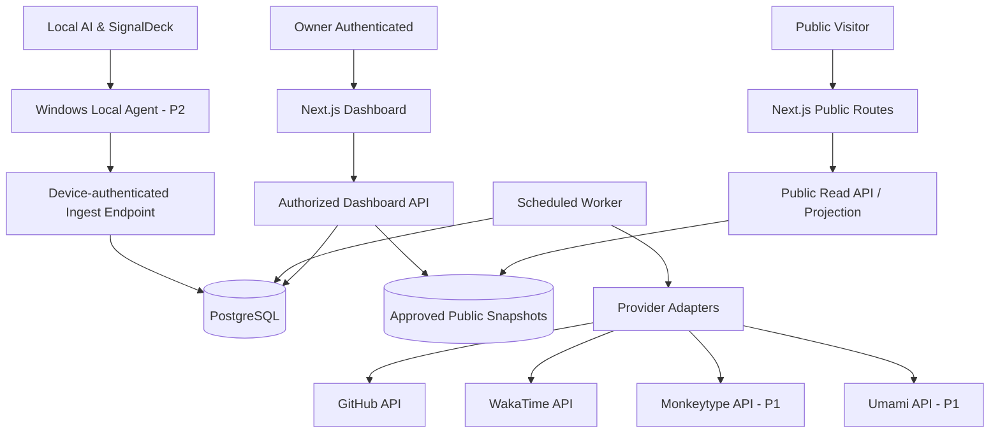

# Technical Architecture & Data Contracts

## 1. Decisions (proposal)

- **Architecture:** modular monolith at first, not premature microservices.
- **Web:** Next.js App Router, TypeScript strict, Tailwind CSS, shadcn/ui, ECharts/Recharts where appropriate.
- **Database:** PostgreSQL + Drizzle ORM with migrations, one database schema for P0/P1.
- **Authentication:** One supported auth provider; choose Supabase Auth initially. Never implement a second bespoke password system.
- **Background jobs:** host-independent scheduler adapter; worker can run on scheduled function or small worker service; use periodic backfill, concurrency limit.
- **Hosting:** managed Next.js deployment and managed Postgres; choose actual plan after budget analysis.
- **P2 local:** Python Windows daemon/CLI running outbound-only HTTPS signed requests; no incoming remote port.

## 2. Logical architecture



## 3. Schema baseline (logical, not finished SQL)

### Identity/content
- `owner_profiles`: owner_id PK, public_handle, display_name, about, avatar_url, publish_status, updated_at.
- `projects`: id PK, slug unique, title, summary, description, status, visibility, featured, created_at, updated_at.
- `project_tech`: project_id FK, technology_id FK.
- `project_media`: id PK, project_id FK, url, alt, kind, sort_index, visibility.
- `milestones`: id PK, project_id FK, title, weight DECIMAL positive, status, completed_at, visibility.
- `project_tasks`: id PK, milestone_id FK, title, state, checklist, due_date, visibility.
- `activity_events`: id PK, project_id optional FK, kind, title, occurred_at UTC, source, visibility.

### Integration/analytics
- `integrations`: id PK, provider, account_alias, state, scopes, last_success_at, created_at; store only encrypted token references, **not plaintext tokens**.
- `sync_runs`: id PK, integration_id FK, started_at, ended_at, status, rows_ingested, error_code, cursor_redacted.
- `source_records`: id PK, provider, external_id, payload_minimal, collected_at; unique(provider, external_id) where applicable.
- `metric_points`: id PK, metric_key, provider, group_key, period_start_utc, period_end_utc, timezone, unit, value, collected_at, source_record_id; unique(provider, metric_key, group_key, period_start_utc, period_end_utc) per normalization policy.
- `metric_aggregates`: id PK, metric_key, granularity, period_start_utc, value, unit, computed_at, coverage, last_source_at.
- `public_snapshots`: id PK, published_at, owner_version, content_json_sanitized, expires_at optional, revoked_at optional.
- `visibility_policies`: id PK, resource_type, resource_key, public_enabled, allowed_fields, updated_at.
- `audit_logs`: id PK, actor, action, entity_type, entity_id, occurred_at, metadata_sanitized.
- `local_devices`: id PK, public_label, credential_ref, state, last_seen_at, revoked_at.
- `local_metric_aggregates` (P2): device_id, metric_key, bucket_start_utc, bucket_seconds, numeric_value, unit, source_version; unique(device_id, metric_key, bucket_start_utc).

Database constraints: FKs; positive weights; no negative durations; typed metrics; unique slug; explicit delete policy; access control tested.

## 4. Metric data contract

```json
{
  "metric_key": "coding_duration_seconds",
  "provider": "wakatime",
  "source_account_alias": "owner-primary",
  "period_start_utc": "2026-10-16T00:00:00Z",
  "period_end_utc": "2026-10-17T00:00:00Z",
  "timezone": "Asia/Jakarta",
  "unit": "seconds",
  "value": null,
  "collected_at": null,
  "sync_state": "not_connected",
  "visibility": "private"
}
```

`null` is intentional: example schema only, no invented statistics. Public projection includes sanitized fields and no integration access tokens.

## 5. Server route surface

```text
GET    /api/public/profile
GET    /api/public/projects
GET    /api/public/projects/:slug
GET    /api/public/stats
POST   /api/auth/*                 (provider-managed)
GET    /api/owner/overview
GET    /api/owner/projects
POST   /api/owner/projects
PATCH  /api/owner/projects/:id
DELETE /api/owner/projects/:id
POST   /api/owner/projects/:id/milestones
PATCH  /api/owner/milestones/:id
GET    /api/owner/integrations
POST   /api/owner/integrations/:provider/sync
PATCH  /api/owner/privacy
POST   /api/internal/sync/:provider   (job credential only)
POST   /api/ingest/local              (device credential only, P2)
```

`/api/internal/*` must not rely only on obscured URLs; use verified service identity. Public routes should limit abuse and return only approved fields.

## 6. Sync algorithm and failure behavior

1. Scheduler enqueues a provider sync job by provider/account/time window.
2. Lock prevents parallel duplicate runs; mark `sync_runs.status=running`.
3. Adapter fetches provider data using authorized server-only token; pagination/backfill within provider limits.
4. Validate schema, normalize timezone/units, upsert by deterministic idempotency key.
5. Recalculate affected aggregates and record `coverage`.
6. Update `last_success_at`, `sync_runs` and durable cursor.
7. Rebuild public projection **only for approved resources**.
8. On 429/error: bounded exponential backoff; show stale last-known values; avoid overwriting valid values with null/zero.

Requested sync frequency should be configured per provider and hosting budget. Do not promise minute-level refresh on a hosting tier that doesn't allow it.

## 7. Progress calculation

`progress_percent = 100 × sum(weight of DONE milestones) / sum(weight of ALL milestones)`.

Rules: all weights positive; weights editable only by owner; zero milestones => `not_started`, not an assumed 0%-complete claim; if blocked/paused project, progress value persists separately from project state. Verified automation may recommend completion but owner approval is default.

## 8. Auth and privacy boundary

- Owner sessions validated server-side per request; RBAC single owner.
- Never expose service role key or WakaTime/Monkeytype/GitHub tokens to client.
- Separate DB roles or RLS/queries for public projection vs owner CRUD.
- Ownership checks mandatory on all project, milestone, and analytics IDs; avoid IDOR.
- Updates to `visibility_policies` invalidate and rebuild public snapshot synchronously or revoke old snapshot first; no window exposing revoked data.
- Logs exclude full request bodies, raw source code, chat content, secrets, precise local file paths.

## 9. Local agent contract (P2)

- Collector reads optional documented sources from local AI runtime and SignalDeck.
- Aggregates at configured intervals; offline spool max age and size limits; persistent IDs for upsert.
- Signed HTTPS request to cloud ingress; device token scope only ingest and only its device ID; rotate/revoke.
- Never remote-control OC/UV/fan/power settings from public cloud.
- No default collection of prompts, translated game content, raw logs or private project file names.
- `is_live` true only if last verified sample is within user-configured freshness threshold; otherwise stale/offline.

## 10. Testing architecture

- Unit: metric normalization, progress calculation, visibility filtering, date bucketing.
- Adapter contract fixtures for each provider; error 401/403/429/500 and empty states.
- Integration: migrations, upsert idempotency, snapshot revoke, auth/authorization, retries.
- E2E: visitor vs owner, project CRUD, public toggle, chart filters, responsive navigation.
- Security: secret scans, access control, rate limiting, unsafe URL input and XSS cases.

## 11. Delivery infrastructure

- Dev/staging/prod environment separation; no production secrets in local fixtures.
- Migrations reviewed and reversible where feasible, backup before risky schema migration.
- Pull-request CI lint, types, unit, integration, build, E2E smoke for P0.
- Health dashboard for job failures and integration last-sync.
- Document recovery and rollback procedures before first public deployment.
